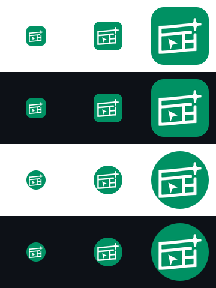

# Avatar PNG export correction

The previous PNG flattened canonical transparent corners onto white. This created a visible white bezel on GitHub's dark backgrounds. The canonical avatar also used a smaller glyph than the owner wanted for GitHub placements.

The approved A2.1 SVG files remain byte-identical. [Export settings](../../../brand-kit/avatar-export.json) change only the outer glyph placement from `translate(6.72 6.72) scale(0.72)` to `translate(-1.92 -1.92) scale(1.08)`: a 1.5× glyph scale centered at SVG coordinate (24,24). The tile radius, logo green, white strokes, inner transform, paths and cutout mask are unchanged. The PNG exterior stays transparent; no white matte is added.

The earlier HQ icon was inspected as the framing reference. Its artwork occupied much more of the image than the initial Sites avatar. This export enlarges the Sites glyph while retaining space for circular GitHub crops; it does not reuse the HQ paths or invent a different Sites silhouette.

## Pixel checks

- 512 × 512, four RGBA channels.
- All four corner alpha values are exactly 0.
- 831 partially transparent pixels around the rounded tile; their premultiplied RGB matches logo green within one 8-bit level, with red=0. This rules out a white matte at the tile boundary.
- Fully opaque white glyph bounding box: x=66…445, y=98…413, centered at (255.5,255.5). Width380px, about74.2% of the canvas, compared with roughly49.5% previously.
- Every fully opaque white glyph pixel lies inside a centered circular crop of radius256px.
- Exported32/48/96px PNG corners remain alpha0. Visual review shows a readable cursor/site-layout glyph without white halos on both backgrounds.
- Canonical checksums and profile references pass; `git diff --check` passes.

Columns show32,48,96px. Rows show square on white, square on ink, circular crop on white, circular crop on ink. This is a deterministic composite for export QA, not a screenshot of a completed GitHub update.

PNG SHA-256: `ac2feb218a6988c4a4a3116cfb5048286546a4558fc2655310281ade6076a905`.

Reproduce with `node scripts/build-brand-assets.mjs` and `node scripts/verify-brand-assets.mjs`. Organization-avatar delivery is separate from repository merge; this document does not claim either action has occurred.
